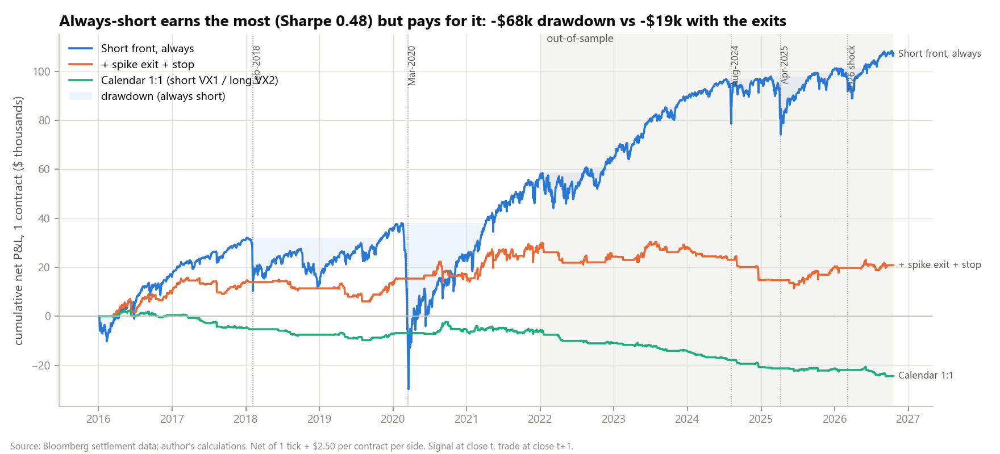
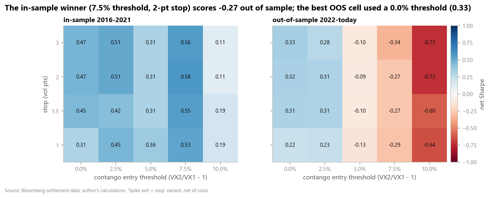
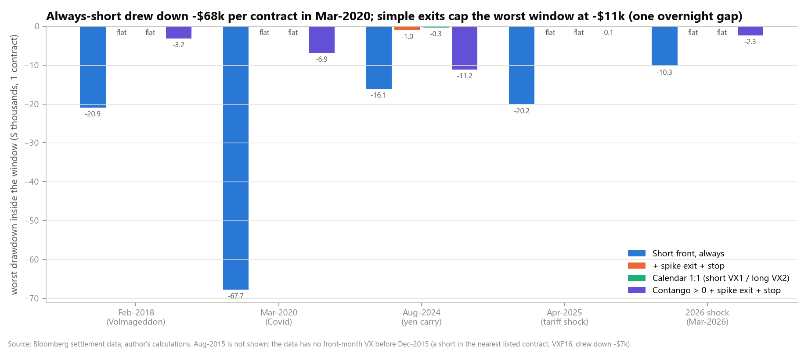
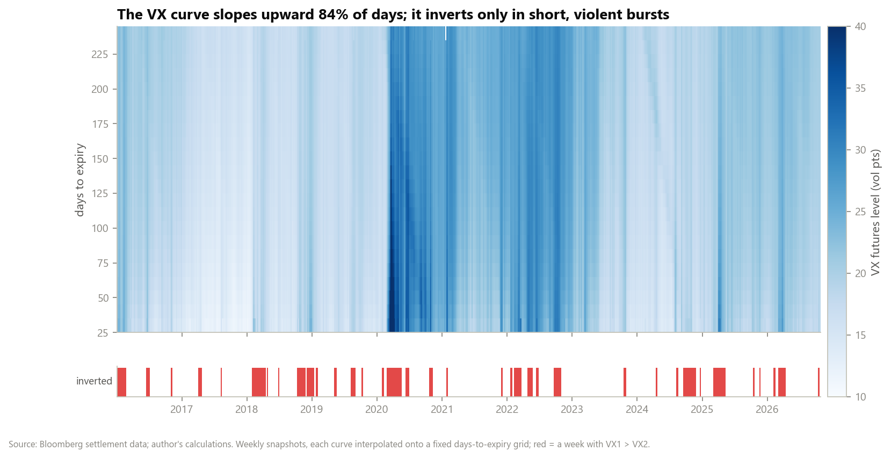
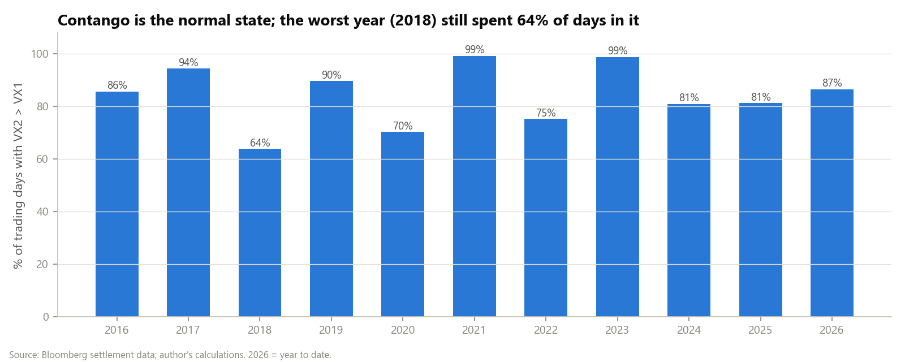
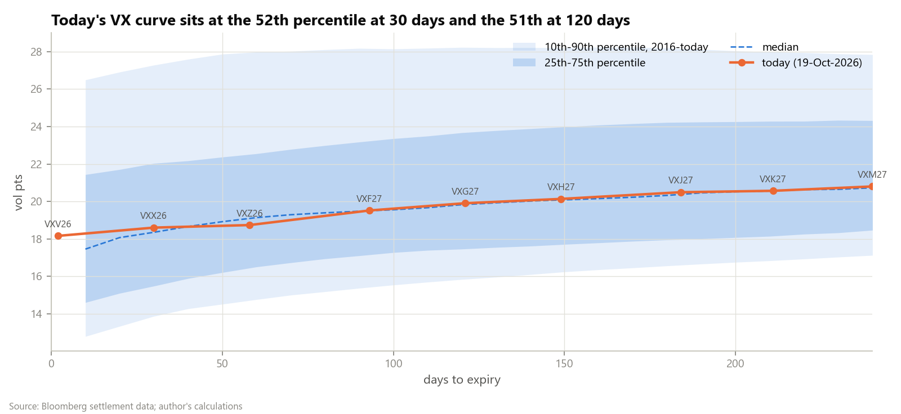
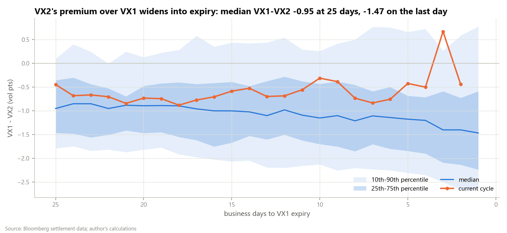
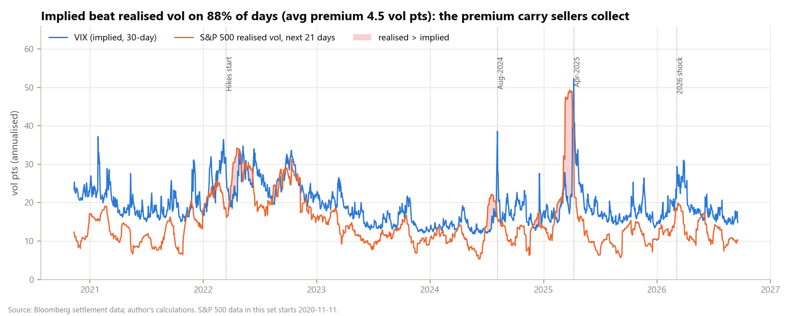
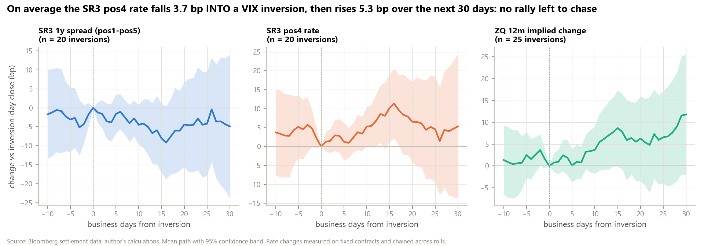
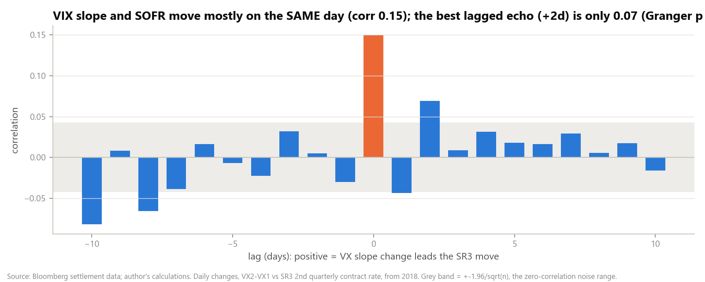

# VIX Futures Term Structure: Carry, Tail Risk and the Signal for Rates

**[Interactive report (Plotly, hover for values)](https://atharvadeshpande002.github.io/vix-term-structure-carry/reports/report.html)** · [Walkthrough notebook](notebooks/walkthrough.ipynb) · [Interview notes](INTERVIEW_NOTES.md)

How much does the VIX futures curve pay a trader for being short volatility, how do you survive the blow-ups, and
does stress in the VIX curve tell a SOFR / Fed funds trader anything? This is a study for a STIR and volatility
futures trader, from VX and SR3 settlement data, 2016 to Oct-2026.

## Key findings

- **The carry is real and steady.** The VX curve was in contango (VX2 > VX1) on **84%** of days. In contango the front
  contract drifted toward spot VIX by **0.069 vol pts a day** on average (about **$69 per contract per day**). Implied
  volatility (VIX) beat the S&P 500's realised volatility over the next 21 days on **88%** of days, by **4.5 vol pts**
  on average (S&P data from Nov-2020).
- **It is paid for crash risk.** Always being short one front contract made **$107k net** over 2016 to 2026
  (**Sharpe 0.48**, 0.58 out of sample). But it drew down **$68k per contract in March 2020** and **$21k in Feb-2018**.
  Its worst day was **-$17.6k** (5-Feb-2018), and it took 273 business days to recover from the March 2020 trough.
- **Simple defences beat tuned ones.** "Short only in contango, flat after an inversion or a 20% VIX jump, 2-pt stop"
  kept **Sharpe 0.40** (0.32 out of sample) and cut the worst crisis-window drawdown from $68k to **$11k**. That $11k
  was one overnight gap on 5-Aug-2024, which no exit rule can avoid. The threshold **optimised in-sample** (7.5%
  contango, Sharpe 0.58 for 2016 to 2021) **failed out of sample (Sharpe -0.27, 2022 onward)**. This is a clean
  example of over-fitting.
- **Calendar spreads don't rescue it.** Short VX1 / long VX2 hedges the tail, but VX2 rolls down too. The small gross
  carry left (+$13.8k in ten years) is less than the cost of trading two legs ($38k), so it lost **$24k net**
  (Sharpe -0.87).
- **VIX and SOFR move on the same day, not in sequence.** In weeks when VIX rose more than 5 points, the SR3 2nd to
  8th contracts rallied **5 to 11 bp more** than in other weeks (t ≈ -2.0 to -2.6). Across 20 VIX-curve inversions,
  SR3 pos4 had already fallen **3.7 bp** in the 10 days before. It then **rose 5.2 bp** over the next 10 days. Buying
  SR3 after an inversion lost money out of sample (11 events, -$387 per trade vs -$298 for the same trade on a random
  day).

## Hero chart



## Why this matters on a desk

- **Sizing a short-vol book:** the tail table tells you how much one contract can lose in a real shock ($10k to $68k),
  so you can size from the loss you can survive, not from the carry you want.
- **Rules a risk manager will accept:** "flat when the curve inverts" is simple, explainable and survived out of
  sample. A tuned contango threshold is not.
- **For a rates trader:** VIX stress coincides with a SOFR rally, but the inversion itself arrives late. Treat it as
  confirmation of a risk-off move, not as a signal to start receiving SOFR.
- **Every morning:** `scripts/screen_today.py` places today's basis, slope and contango in their history and in the
  expiry cycle, and tells you whether the carry signal is on.

## Method

| Step | What | Formula / rule |
|---|---|---|
| 1 | Term structure | VXk = k-th contract with expiry after today. basis = VX1 - VIX; slope = VX2 - VX1; contango = VX2/VX1 - 1; roll yield = basis / days to expiry; CM-30 = linear interpolation in days between the contracts straddling 30 days |
| 1 | Variance risk premium | VIX(t) - realised S&P 500 vol over t+1..t+21 (annualised). Descriptive only, never a signal |
| 2 | Traded contract | nearest VX with **> 5 business days** to expiry, rolled 5 days before expiry. P&L = change of the same contract's settle x $1,000, **never across a roll** |
| 2 | Timing | signal at the close of t, trade at the settle of t+1, P&L from t+1 to t+2 onward |
| 2 | Costs | 1 tick ($50) + $2.50 per contract per side, on every entry, exit and roll |
| 2 | Variants | always short; contango filter; + spike exit (flat 5 days if VX1 > VX2 or VIX +20% in a day); + stop (vol pts); calendar 1:1 and beta-weighted (60-day OLS); vol-targeted ($1,000 daily s.d., max 10 lots) |
| 2 | Out-of-sample | threshold x stop chosen on **2016 to 2021** by Sharpe; **2022 to Oct-2026** never used for the choice |
| 2 | Tails | per crisis window: P&L, worst day, worst week, drawdown inside the window, business days to regain the prior high |
| 3 | Seasonality | VX1 - VX2 and basis by business days to VX1 expiry: 10/25/50/75/90th percentiles across all cycles, current cycle overlaid |
| 4 | Inversion events | first day VX1 > VX2 after ≥ 20 contango days. Paths -10..+30 days of SR3 pos1-pos5, SR3 pos4, ZQ(12m ahead) - ZQ(current month); mean ± 1.96 s.e. |
| 4 | Lead-lag | corr(Δ(VX2-VX1)_t, ΔSR3pos2_{t+lag}), lags -10..+10; Granger F-tests, 1 to 5 lags, both directions |
| 4 | Translation trade | buy the SR3 4th quarterly contract at the close after an inversion, hold 20 days, vs the same trade every day |

SR3 positions are the k-th **quarterly** SOFR future whose last trading day is after today. Daily changes are measured
on the contract that held the position yesterday, then chained. Rates are 100 - price in bp. Spreads are front minus
back in rate terms.

## Results

### Carry strategies, 1 contract, net of costs

| Strategy | In-sample Sharpe (2016 to 2021) | **Out-of-sample Sharpe (2022 to Oct-2026)** | Full net P&L | Full max drawdown | Worst day |
|---|---:|---:|---:|---:|---:|
| Short front, always | 0.42 | **0.58** | $107.0k | -$67.9k | -$17.6k |
| Contango > 0 + spike exit + stop (2 pts), not optimised | 0.47 | **0.32** | $52.9k | -$26.1k | -$13.3k |
| Optimised: contango > 7.5% + spike exit + stop | 0.58 | **-0.27** | $20.9k | -$18.9k | -$6.2k |
| Contango > 7.5% filter only | 0.47 | -0.22 | $17.8k | -$21.8k | -$6.2k |
| + spike exit | 0.56 | -0.34 | $17.9k | -$20.9k | -$6.2k |
| Calendar 1:1 (short VX1 / long VX2) | -0.33 | -1.79 | -$24.4k | -$26.9k | -$1.9k |
| Calendar beta-weighted | -1.38 | -2.88 | -$40.4k | -$42.2k | -$1.0k |
| Optimised, vol-targeted | 0.34 | -0.31 | $8.5k | -$26.0k | -$11.7k |

Full table with trades, hit rate, average win/loss, holding days and costs: [`reports/results/strategy_summary.csv`](reports/results/strategy_summary.csv).



### Tail analysis: drawdown inside each crisis window, 1 contract

| Window | Always short | Contango > 0 + exits | Optimised (7.5%) + exits | Calendar 1:1 |
|---|---:|---:|---:|---:|
| Aug-2015 (China deval) | n/a* | n/a* | n/a* | n/a* |
| Feb-2018 (Volmageddon) | -$20.9k | -$3.2k | flat | flat |
| Mar-2020 (Covid) | -$67.7k | -$6.9k | flat | flat |
| Aug-2024 (yen carry unwind) | -$16.1k | -$11.2k | -$1.0k | -$0.3k |
| Apr-2025 (tariff shock) | -$20.2k | -$0.1k | flat | flat |
| 2026 shock (Mar-2026) | -$10.3k | -$2.3k | flat | flat |

\*The data has no front-month VX before Dec-2015. As a proxy, a short in the nearest listed contract (VXF16,
4 to 5 months out) drew down $6.7k through the window. Full table: [`reports/results/tail_windows.csv`](reports/results/tail_windows.csv).



### Term structure, seasonality and the variance risk premium



| | |
|---|---|
|  |  |
|  |  |

VX2's premium over VX1 widens into expiry: the median VX1 - VX2 is -0.95 vol pts 25 business days out and -1.47 on
the last day, because VX1 converges to spot.

### VIX → rates



| Around 20 VX inversions (SR3 from 2018) | -10 → 0 days | 0 → +10 days (95% band) | 0 → +30 days (95% band) |
|---|---:|---:|---:|
| SR3 pos4 rate | -3.7 bp | +5.2 bp (+0.1 to +10.4) | +5.3 bp (-13.7 to +24.4) |
| SR3 1y spread (pos1 - pos5) | +1.7 bp | -4.5 bp (-9.7 to +0.8) | -4.9 bp (-23.9 to +14.1) |
| ZQ 12m ahead - current month (25 events) | -1.4 bp | +3.7 bp (-1.8 to +9.2) | +11.8 bp (-2.0 to +25.6) |



- The same-day correlation of VX slope and SR3 pos2 changes is **0.15**. The best lagged value is only 0.07 (+2 days).
  The Granger test "VX slope → SR3" gives p = 0.013 at 2 lags, and the reverse gives p ≥ 0.19. That is statistically
  detectable but economically tiny.
- Stress weeks (VIX up more than 5 points, 27 weeks since 2018): SR3 pos5 rate -10.4 bp versus other weeks (t = -2.5).
  Pos1 barely moves (-0.4 bp, not significant), because the front is anchored by the current policy rate.
- Translation trade (buy SR3 pos4 after an inversion, hold 20 days): in-sample +$114 per trade (9 events) vs +$68
  baseline. Out of sample -$387 (11 events) vs -$298 baseline. **There is no edge.**

## Limitations and honest caveats

- **Daily settles only.** Exits trade at the next settle, so intraday stops and gaps are not modelled. The 5-Aug-2024
  loss shows how much an overnight gap can cost.
- **Costs are an assumption** (1 tick + $2.50 per side). VX spreads widen sharply in a crisis, exactly when the exits
  trade, so crisis exits are probably cheaper here than in reality.
- **Short history for some inputs.** Spot VIX starts 2016, S&P 500 Nov-2020, SR3 May-2018. Aug-2015 is covered only by
  a proxy. The 2y Treasury yield was planned but is not populated in this data set.
- **Few events.** There are 26 VX inversions (20 with SR3 data), so the event-study bands are wide. Some inversions
  coincide with FOMC hiking days in 2022, which mixes a risk-off signal with policy shocks.
- **One out-of-sample split** (2016 to 2021 / 2022 onward), not a rolling walk-forward. The parameter grid is small
  (5 thresholds x 4 stops) and the whole grid is shown.
- **Multiple variants were compared**, so the best-looking one is flattered. That is why the parameter-free rule is
  shown next to the optimised one.
- **Not modelled:** margin, financing, contract-size limits, liquidity of the deferred months, VX options or VIX ETP flows.

## How to run

```bash
pip install -r requirements.txt
# put the CSVs described in data/README.md into data/raw/
python scripts/run_all.py          # all results, charts and reports/report.html (about 10 s)
python scripts/screen_today.py     # today's VX screen -> reports/screen_today.csv / .html
python scripts/build_notebook.py   # re-execute notebooks/walkthrough.ipynb
pytest                             # roll handling, no look-ahead, maths, costs, 3 hand-checked dates
```

All parameters (dates, thresholds, costs, windows) live in [`config.yaml`](config.yaml).

```
src/vixcarry/   load.py · termstructure.py · strategies.py · backtest.py · seasonality.py · crossasset.py · pipeline.py · plots.py · report.py
scripts/        run_all.py · screen_today.py · build_notebook.py
reports/        report.html · figures/*.png · results/*.csv (derived tables only)
tests/          rolls · no look-ahead · maths · spot checks (SPOT_CHECKS.md)
```

## Next steps

- Intraday (or at least open/high/low) VX data, to model gap risk and realistic exit fills.
- A rolling walk-forward of the parameter choice instead of one split.
- Hedge the short-vol book with VIX calls or SPX puts, and compare the cost of insurance with the drawdown it removes.
- Extend the rates side with Treasury yields and condition the event study on the Fed regime (hiking / cutting / hold).

---
Source: Bloomberg settlement data; author's calculations. Raw data is licensed and not included. Not investment advice.
